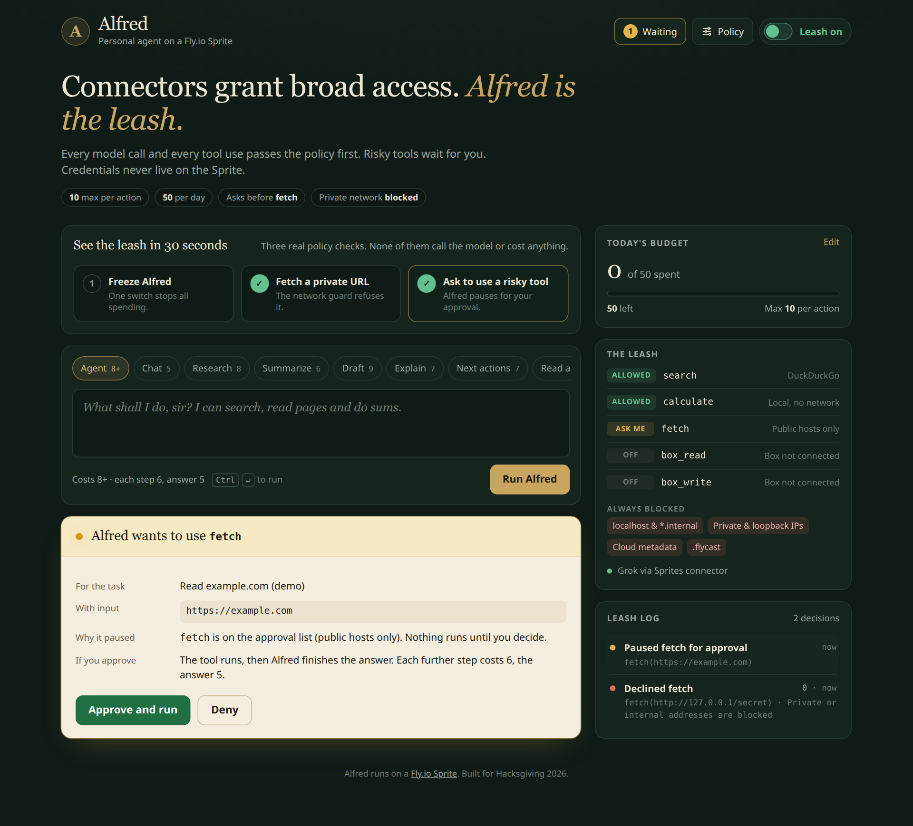
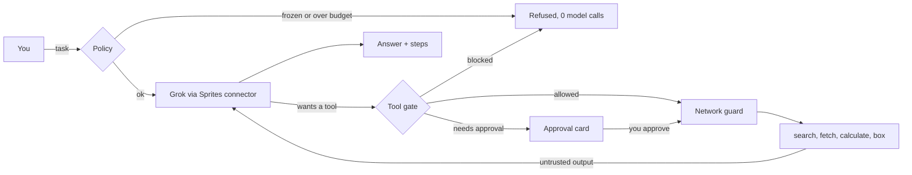
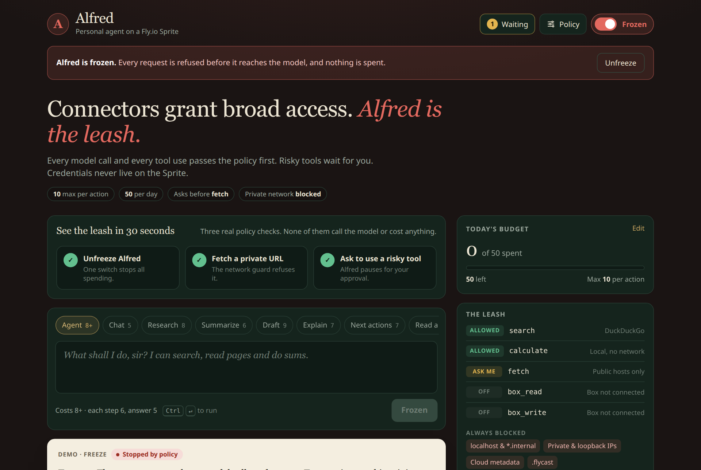
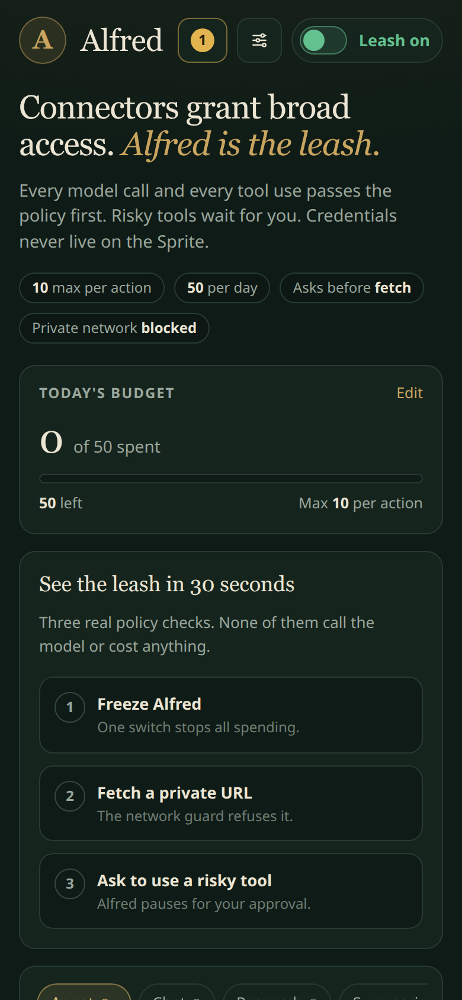

# Alfred

**Connectors grant broad access. Alfred is the leash.**

Alfred is a personal agent that runs on a [Fly.io Sprite](https://fly.io/sprites). Before any model call or tool use, it checks a policy you control: a spending budget, a kill switch, a list of tools that need your approval, and a network guard. The agent never holds the credentials. The model and Box are reached through Sprites connectors.

Built for [Hacksgiving 2026](https://fly.io/hacksgiving/).

**Live:** https://alfred-b6vev.sprites.app



## Try it in 30 seconds

Open the [live site](https://alfred-b6vev.sprites.app) and use **See the leash in 30 seconds**. None of the three steps calls the model or costs anything:

1. **Freeze Alfred.** The page turns red. Anything you ask now is refused before it reaches the model, at cost 0. Unfreeze from the banner.
2. **Fetch a private URL.** Alfred tries `http://127.0.0.1/secret`. The network guard refuses it.
3. **Ask to use a risky tool.** Alfred pauses and shows an approval card: the tool, the input, why it paused, and what approving will cost.

Every decision appears in the **Leash log** on the right. Then give the agent a real task, such as *"What's new on the Fly.io blog?"*, and watch each step pass through the leash.

## Why

A connector hands an agent a credential with broad scope: a whole model account, or `root_readwrite` on Box. The agent can then do anything that credential allows. Alfred adds narrower, enforceable rules between the agent and the connector, and shows its decisions to you.

## How it works



- **Before every model call:** freeze and budget checks (per action and per day). A frozen or broke agent makes zero model calls.
- **Before every tool:** the tool gate decides whether the tool is allowed, needs your approval, or is refused.
- **Before every fetch:** the network guard resolves DNS and blocks `localhost`, `*.internal`, `.flycast`, private and loopback IPs, and cloud metadata addresses, including through redirects.
- **Tool output** is wrapped as untrusted, and the model is told never to follow instructions inside it.
- **Freeze takes effect mid-run.** The agent re-reads the policy before each model call and tool, so freezing stops it at the next one. You can't approve tools while Alfred is frozen.

## What the leash enforces

| Rule | Default | Change with |
|---|---|---|
| Max spend per action | 10 | Policy dialog, or `POST /limits` |
| Daily budget | 50 | Policy dialog, or `POST /limits` |
| Kill switch | off | The switch in the header, or `POST /freeze` |
| Tools that need approval | `fetch`, `box_write` | `ALFRED_APPROVE_TOOLS` |
| Hosts `fetch` may reach | any public host | `ALFRED_ALLOWED_DOMAINS` |
| Box folders the agent may read | none | `BOX_ALLOWED_FOLDERS` |
| Box folder the agent may write | one outbox only | `BOX_OUTBOX_ID` (the agent can't pick another) |

## Hacksgiving checklist

- Runs on a Fly.io Sprite: https://alfred-b6vev.sprites.app
- Uses Sprites connectors: a Custom API connector for xAI Grok (the agent never holds the API key), and optionally Box and Exa
- Built during Nov 23–29, 2026

## Run it

Needs Node 20+.

```bash
npm install
npm test          # 33 tests: policy, agent loop, freeze mid-run, network guard, tools, leash log
npm run web       # http://localhost:8080
```

On a Sprite:

```bash
sprite exec -s alfred -- bash -c "cd Alfred && ALFRED_TOKEN=change-me agent/start.sh"
```

Set `ALFRED_TOKEN` on any public deployment. Without it, anyone can change the policy.

## Configuration

See [`.env.example`](.env.example).

| Variable | What it does |
|---|---|
| `ALFRED_TOKEN` | Owner token. Required to freeze, change limits, approve, and see questions, answers and tool inputs |
| `LLM_CONNECTOR_ID` | Sprites Custom API connector for Grok |
| `LLM_MODEL` | Model name (default `grok-4.7`) |
| `ALFRED_APPROVE_TOOLS` | Tools that pause for approval (default `fetch,box_write`) |
| `ALFRED_ALLOWED_DOMAINS` | If set, `fetch` may only reach these domains |
| `EXA_GATEWAY_URL` | Exa connector for search. Falls back to DuckDuckGo |
| `BOX_GATEWAY_URL`, `BOX_ALLOWED_FOLDERS`, `BOX_OUTBOX_ID` | Box connector, read allowlist, write outbox |
| `ALFRED_STATE` | State file (default `~/.alfred/state.json`) |
| `PORT` | Default `8080` |

## API

| Route | Who | What |
|---|---|---|
| `GET /status` | anyone | Budget, frozen state and the leash log. Visitors see decision types only; the owner also sees questions, answers and tool inputs |
| `GET /policy` | anyone | The rules the leash enforces. No secrets |
| `POST /ask` | anyone, rate-limited | `{ task, topic }`. Runs under the policy and spends the budget |
| `GET /approvals` | owner | Pending approvals |
| `POST /approvals/:id/approve` or `/deny` | owner | Decide a paused tool |
| `POST /freeze`, `/limits`, `/reset`, `/clear-history` | owner | Change the leash |

The owner proves identity with the `x-alfred-token` header, compared in constant time.

## Security notes

- Credentials live in Sprites connectors, not on the Sprite.
- State is written atomically to `~/.alfred/state.json`.
- The UI escapes all text before rendering the small Markdown subset it supports.
- `/ask` is public by design so judges can try it. It is rate-limited per client and can never spend more than the daily budget.

## Screenshots

| Frozen | Phone |
|---|---|
|  |  |
